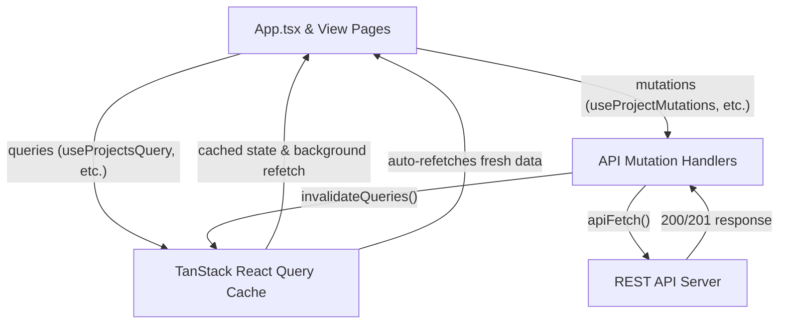
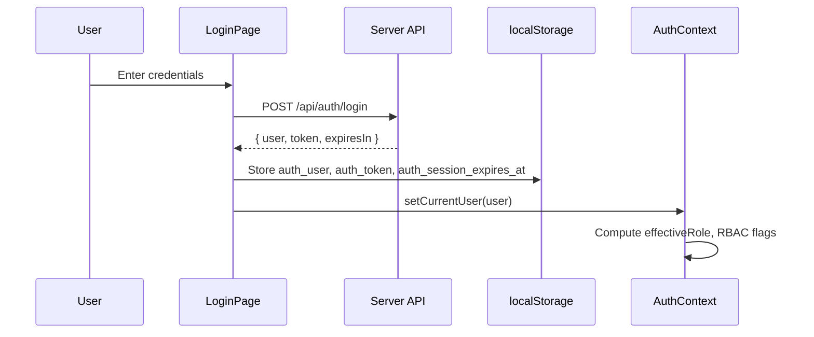
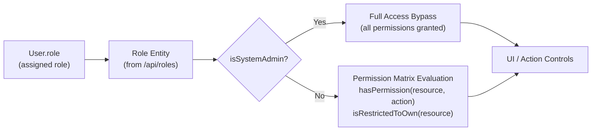
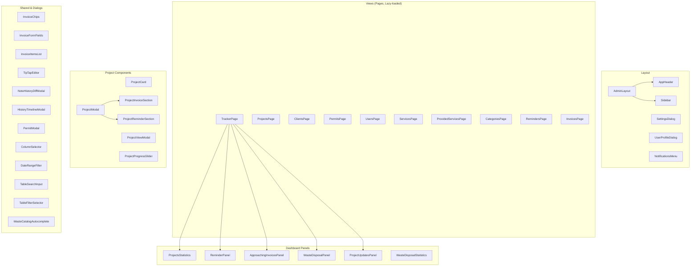
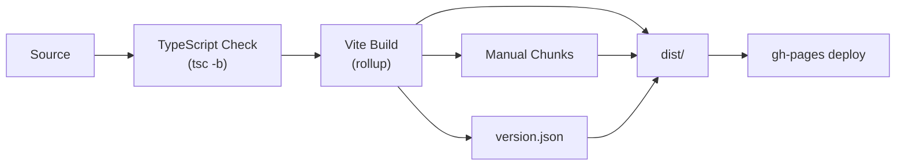
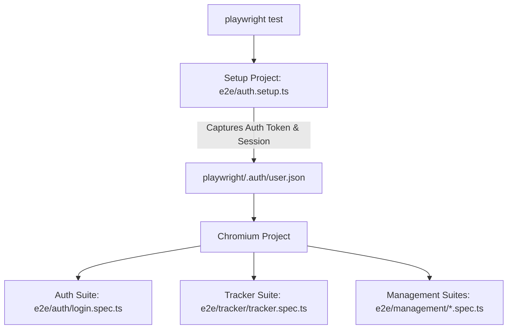
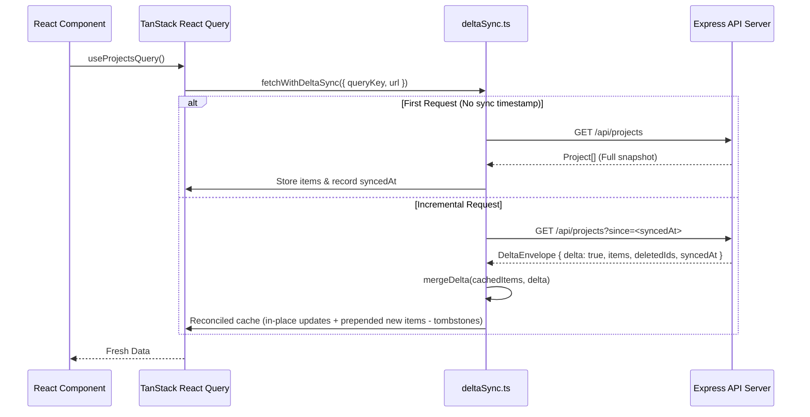

# Client Architecture — Ekos Project Tracker

> Comprehensive architecture reference for the client-side SPA.

---

## 1. Technology Stack

| Layer | Technology | Version |
|---|---|---|
| **Runtime** | React | 19.2.x |
| **Language** | TypeScript | 6.0.x |
| **Build Tool** | Vite | 8.3.x |
| **UI Framework** | Material UI (MUI) | 9.3.x |
| **CSS-in-JS** | Emotion | 11.14.x |
| **Charts** | MUI X Charts | 9.11.x |
| **Rich Text Editor** | TipTap (`@tiptap/react`, `@tiptap/starter-kit`, `@tiptap/extension-mention`, `@tiptap/extension-table`) | 3.20.x |
| **HTML Sanitizer** | DOMPurify | 3.3.x |
| **Offline Storage** | IndexedDB (`ekos_project_tracker_db`) + `BroadcastChannel` | Native Web APIs |
| **State & Caching** | TanStack React Query + Delta Sync Engine | 5.102.x |
| **Linting** | oxlint | 1.75.x |
| **Deployment** | GitHub Pages (gh-pages) | 6.3.x |
| **Routing** | React Router DOM | 7.18.x |
| **E2E Testing** | Playwright | 1.64.x |
| **Unit Testing** | Vitest + Testing Library | 5.0.x / 16.3.x |
| **API Mocking** | MSW (Mock Service Worker) | 2.15.x |

Navigation is managed via **React Router DOM** with dynamic basename support (`getRouterBasename()`) for GitHub Pages and custom domain deployments. Centralized page routes are defined in [`src/constants/pageRoutes.ts`](file:///Users/nemanja.stanojevic/Documents/zigicode/002_EkosGreenGroup/project_tracker/client/src/constants/pageRoutes.ts).

---

## 2. Application Bootstrap

```
index.html
  └── src/main.tsx
        ├── StrictMode
        └── QueryClientProvider
              └── BrowserRouter (basename={getRouterBasename()})
                    └── <App />
              ├── LanguageProvider        (i18n)
              │   └── AuthProvider        (auth + dynamic RBAC)
              │       └── NotificationProvider (notifications)
              │           └── CustomThemeProvider (MUI theme)
              │               └── <MainApp />   (the actual app)
              └── vite:preloadError handler (auto-reload on chunk miss)
```

### Provider Nesting Order (outermost → innermost)
1. **`LanguageProvider`** — i18n must be available to all other providers
2. **`AuthProvider`** — auth state consumed by notifications and layout
3. **`NotificationProvider`** — depends on `useAuth()` for user context
4. **`CustomThemeProvider`** — MUI theme, depends on user preferences

---

## 3. Application Architecture

### 3.1 `MainApp` — The Root Orchestrator

[`App.tsx`](file:///Users/nemanja.stanojevic/Documents/zigicode/002_EkosGreenGroup/project_tracker/client/src/App.tsx) is the central orchestrator that:
- Coordinates declarative query and mutation hooks from [`src/queries/index.ts`](file:///Users/nemanja.stanojevic/Documents/zigicode/002_EkosGreenGroup/project_tracker/client/src/queries/index.ts)
- Manages global UI state (modals, delete confirmation dialogs, global loading mask)
- Renders active views via React Router `<Routes>` and `<Route>` using `PAGE_ROUTES`
- Handles project modal lifecycle (create/edit/view)

### 3.2 Declarative Data Flow (TanStack React Query)



- **Query Isolation:** Each entity domain (`projects`, `clients`, `invoices`, `permits`, `reminders`, `preferences`, etc.) has dedicated query and mutation hooks in `src/queries/index.ts`.
- **Automatic Cache Invalidation:** Mutations trigger query key invalidation (`queryClient.invalidateQueries({ queryKey: [...] })`), ensuring views update automatically without manual state prop-drilling or circular dependency ref patterns.
- **Optimistic Updates:** User preferences (column visibility, theme mode, language, rows-per-page) are updated optimistically in the React Query cache before server persistence.

### 3.3 State Management

| Mechanism | Usage |
|---|---|
| `TanStack React Query` | Server cache, background polling, entity data & mutations |
| `useState` | Local UI state, active dialogs, transient form data |
| `useContext` | Auth, Language, Theme, Notifications, LoadingMask |
| `useMemo` | Derived statistics, active filter calculations, expensive aggregations |
| `useCallback` | Event handlers and parameterized callback props |
| `localStorage` | JWT token (`auth_token`), authenticated user snapshot, theme, language |

### 3.4 View Routing & Navigation

Navigation uses typed routes defined in `src/constants/pageRoutes.ts` (`PAGE_ROUTES`):

```typescript
type ActiveTab = 'dashboard' | 'projects' | 'clients' | 'permits' |
                 'users' | 'roles' | 'services' | 'providedServices' |
                 'categories' | 'reminders' | 'invoices' |
                 'activity-logs' | 'activity-analytics';
```

Views are **lazy-loaded** via `React.lazy()` + `<Suspense>`:
```typescript
const TrackerPage = React.lazy(() => import('./pages/tracker/TrackerPage'));
const ActivityAnalyticsPage = React.lazy(() => import('./pages/management/ActivityAnalyticsPage'));
```

Sub-tabs exist for:
- **Dashboard**: `'projects' | 'reminders' | 'invoices' | 'waste-disposal' | 'waste-management' | 'statistic'`
- **Provided Services**: `'summary' | 'statistics'`

---

## 4. Authentication & Authorization

### 4.1 Auth Flow



### 4.2 Role-Based Access Control (RBAC)



The system uses dynamic roles configured in the backend database. Default roles include:

| Role | Dashboard | Projects | Clients | Permits | Users | Services | ProvidedServices | Categories | Reminders | Invoices | Activity Logs |
|---|---|---|---|---|---|---|---|---|---|---|---|
| **Administrator** | ✅ | ✅ | ✅ | ✅ | ✅ | ✅ | ✅ | ✅ | ✅ | ✅ | ✅ |
| **Manager** | ✅ | ✅ | ✅ | ✅ | ✅ | ✅ | ✅ | ✅ | ✅ | ✅ | — |
| **Manager (User View)** | ✅ | — | — | — | — | — | — | — | — | — | — |
| **Accountant** | ✅ (invoice-focused) | — | — | — | — | — | — | — | — | — | — |
| **User** | ✅ (personal) | — | — | — | — | — | — | — | — | — | — |

**Manager "Work on Entities" toggle:** Managers can switch between full Manager mode (manage all entities) and a User-like view (only personal dashboard). Controlled via `workOnEntities` flag, persisted in localStorage and server preferences.

### 4.3 Session Management

- **JWT stored** in `localStorage` as `auth_token`
- **Session expiry** tracked client-side via `auth_session_expires_at` (timestamp)
- **Periodic auth check** every 30s via `GET /api/auth/me` — logs out blocked users
- **Session expiry check** every 15s — compares `Date.now()` against stored expiry
- **Page Visibility API** — all polling pauses when tab is hidden, resumes + immediate check on tab focus
- **`auth:expired` custom event** — dispatched by `apiFetch()` on 401, triggers global logout

---

## 5. Internationalization (i18n)

### Architecture

```
src/i18n/
├── translations.ts    ← Type definitions + shared maps
├── loader.ts          ← Dynamic import() based lazy loading
└── locales/
    ├── en.ts          ← English (~27KB)
    ├── sr-Latn.ts     ← Serbian Latin (~28KB) — DEFAULT
    └── sr-Cyrl.ts     ← Serbian Cyrillic (~38KB)
```

### Translation System

| Feature | Implementation |
|---|---|
| **Key lookup** | `t('key')` → string from active dictionary |
| **Interpolation** | `t('key', { count: 5 })` → replaces `{count}` in template |
| **Service labels** | `getServiceLabel(typeCode, services?)` → translated service name |
| **Gender-aware labels** | `getResponsibleLabel(userOrGender, usersList?)` → `Odgovoran/Odgovorna/Odgovorno` |
| **Error translation** | `getErrorMessage(rawError)` → localized error message |
| **Lazy loading** | Locale dictionaries loaded via dynamic `import()` — only active locale is bundled |

### Adding a Translation Key

1. Add the key to the `TranslationKeys` interface in [`translations.ts`](file:///Users/nemanja.stanojevic/Documents/zigicode/EkosGreenGroup/project_tracker/client/src/i18n/translations.ts)
2. Add values in all 3 locale files (`en.ts`, `sr-Latn.ts`, `sr-Cyrl.ts`)
3. Use via `const { t } = useLanguage(); t('myNewKey');`

---

## 6. Theming

### Theme System

The app uses a custom MUI theme defined in [`theme.ts`](file:///Users/nemanja.stanojevic/Documents/zigicode/EkosGreenGroup/project_tracker/client/src/theme/theme.ts):

| Aspect | Light Mode | Dark Mode |
|---|---|---|
| **Primary** | `#2e7d32` (Forest Green) | `#4caf50` (Green) |
| **Secondary** | `#16a34a` | `#34d399` (Emerald) |
| **Background** | `#f4f6f8` / `#ffffff` | `#0b130e` / `#132018` |
| **Text** | `#1b2c22` / `#516758` | `#f0f7f2` / `#9ec1a3` |

**Custom palette extension — `status`:**
| Status | Light | Dark | Used For |
|---|---|---|---|
| `active` | `#2e7d32` | `#4caf50` | Active projects |
| `done` | `#16a34a` | `#34d399` | Completed projects |
| `stale` | `#ed6c02` | `#fb923c` | Stale projects |

**Theme modes:** `light`, `dark`, `system` (auto-detects via `prefers-color-scheme`).

**Typography:** Inter font family, no text-transform on buttons, custom heading weights.

**Global overrides:** Scroll lock disabled on all overlays (Modal, Popover, Menu, Select, Dialog, Drawer) to prevent body scroll issues.

---

## 7. Component Architecture

### 7.1 Layout Shell

```
<AdminLayout>
  ├── <AppHeader />           — Top bar, user menu, notifications
  ├── <Sidebar />             — Navigation, sub-tabs, version
  ├── <main>                  — Active view content
  ├── <UserProfileDialog />   — Profile editor
  ├── <SettingsDialog />      — App settings
  └── <CompanyInfoModal />    — Company details
```

### 7.2 Component Categories



### 7.3 Table View Pattern

All 11 table-based views/panels follow this architecture:

```typescript
function MyPage(props: ViewProps & TableViewProps) {
  // 1. Table infrastructure
  const tableView = useTableView({
    defaultColumns: ['col1', 'col2'],
    visibleColumns: props.visibleColumns,
    onVisibleColumnsChange: props.onVisibleColumnsChange,
    defaultRowsPerPage: 25,
    rowsPerPageProp: props.rowsPerPage,
    onRowsPerPageChange: props.onRowsPerPageChange,
    defaultSortField: 'name',
    sortState: props.sortState,
    onSortChange: props.onSortChange,
    onRefresh: props.onRefresh,
  });

  // 2. CRUD operations
  const { handleSave, handleDelete } = useCrudOperations({
    basePath: '/api/my-entity',
    items, authHeaders, onSuccess, onDeleteConfirm,
    deleteConfirmMessageKey: 'confirmDelete',
    errorSaveMessageKey: 'errorSaving',
  });

  // 3. Render table with sorted/paginated data
  return <MuiTable>...</MuiTable>;
}
```

---

## 8. API Communication

### 8.1 API Client

All HTTP requests go through [`apiFetch()`](file:///Users/nemanja.stanojevic/Documents/zigicode/EkosGreenGroup/project_tracker/client/src/api.ts):

```
apiFetch(path, init?)
  ├── Resolves full URL via VITE_API_BASE_URL
  ├── Auto-attaches Authorization: Bearer <token>
  ├── Auto-attaches X-User-Id header
  ├── Calls native fetch()
  └── On 401 → dispatches 'auth:expired' event → auto logout
```

### 8.2 API Endpoints Consumed

| Endpoint | Methods | Used By |
|---|---|---|
| `/api/auth/login` | POST | AuthContext |
| `/api/auth/register` | POST | AuthContext |
| `/api/auth/me` | GET | AuthContext (polling) |
| `/api/projects` | GET, POST | useAppData, useProjects |
| `/api/projects/:id` | PUT, DELETE | useProjects (via useCrudOperations) |
| `/api/projects/:id/toggle-done` | PATCH | useProjects |
| `/api/projects/stats` | GET | useAppData |
| `/api/clients` | GET, POST | useAppData, useClients |
| `/api/clients/:id` | PUT, DELETE | useClients |
| `/api/users` | GET, POST | useAppData, useUsers |
| `/api/users/:id` | PUT, DELETE | useUsers |
| `/api/users/:id/approve` | PATCH | useUsers |
| `/api/users/:id/reject` | PATCH | useUsers |
| `/api/users/:id/force-logout` | POST | useUsers |
| `/api/services` | GET, POST | useAppData, useServices |
| `/api/services/:id` | PUT, DELETE | useServices |
| `/api/provided-services` | GET, POST | useAppData, useProvidedServices |
| `/api/provided-services/:id` | PUT, DELETE | useProvidedServices |
| `/api/categories` | GET, POST | useAppData, useCategories |
| `/api/categories/:id` | PUT, DELETE | useCategories |
| `/api/reminders` | GET, POST | useAppData, useReminders |
| `/api/reminders/:id` | PUT, DELETE | useReminders |
| `/api/reminders/:id/status` | PATCH | useReminders (via useStatusUpdate) |
| `/api/invoices` | GET, POST | useAppData, useInvoices |
| `/api/invoices/:id` | PUT, DELETE | useInvoices |
| `/api/invoices/:id/status` | PATCH | useInvoices (via useStatusUpdate) |
| `/api/permits` | GET, POST | useAppData, usePermits |
| `/api/permits/:id` | PUT, DELETE | usePermits |
| `/api/waste-catalog` | GET | useAppData |
| `/api/notifications` | GET | NotificationContext |
| `/api/notifications/:id/read` | PATCH | NotificationContext |
| `/api/notifications/mark-all-read` | PATCH | NotificationContext |
| `/api/notifications/:id` | DELETE | NotificationContext |
| `/api/notifications/clear-all` | DELETE | NotificationContext |
| `/api/company-info` | GET, PUT | CompanyInfoModal |
| `/api/preferences` | GET | useAppData |
| `/api/preferences/:key` | PUT | useAppData |

### 8.3 Dev Server Proxy

```typescript
// vite.config.ts
server: {
  port: 3000,
  proxy: {
    "/api": {
      target: "http://localhost:5000",
      changeOrigin: true,
    },
  },
},
```

---

## 9. Build & Deployment

### 9.1 Build Pipeline



### 9.2 Chunk Strategy

| Chunk Name | Contents | Rationale |
|---|---|---|
| `vendor-react` | react, react-dom | Rarely changes, long cache |
| `vendor-mui` | @mui/material, @emotion/* | Large, stable |
| `vendor-mui-icons` | @mui/icons-material | Tree-shaken via barrel file |
| `vendor-mui-charts` | @mui/x-charts | Only used in dashboard analytics |
| Per-view chunks | Each lazy-loaded view | Code-split per route |

### 9.3 Version System

Build-time globals injected via Vite `define`:
- `__APP_VERSION__` — from git tag → package.json → `1.0.0`
- `__COMMIT_HASH__` — `git rev-parse --short HEAD`
- `__BUILD_TIME__` — ISO timestamp

Runtime `version.json` emitted to `dist/` — polled by `useVersionCheck` hook to detect new deployments and show an update banner.

### 9.4 CI/CD

Automated via GitHub Actions:
- **E2E Testing (`.github/workflows/playwright.yml`)**: Runs Playwright test suite against headless Chromium on push/PR to `main`/`master`, with automatic artifact upload of trace recordings and reports on failure.
- **Release & Deployment Workflow**: On PR merge to `main`:
  1. Determine version bump from PR labels/title (conventional commits)
  2. Bump `package.json` version
  3. Update `CHANGELOG.md`
  4. Create git tag + GitHub Release
  5. Trigger deploy to GitHub Pages

---

## 10. Testing Architecture

### 10.1 Unit & Component Testing (Vitest)
- **Runner**: Vitest with `@testing-library/react` and `jsdom`.
- **API Mocking**: Mock Service Worker (MSW) in `src/mocks` simulates backend endpoints for component-level isolation.
- **Coverage**: Evaluated via `npm run test:coverage`.

### 10.2 End-to-End Testing (Playwright)
The application includes an automated E2E testing framework powered by `@playwright/test` located in `client/e2e/`:



- **Global Setup (`e2e/auth.setup.ts`)**: Authenticates against the backend once and persists JWT session state to `playwright/.auth/user.json`.
- **Suites**:
  - `auth/login.spec.ts`: Valid/invalid logins, error display, logout flows.
  - `tracker/tracker.spec.ts`: KPI cards, active projects overview, quick filters.
  - `management/projects.spec.ts`: Project creation, edit, quick filter tabs, delete.
  - `management/clients.spec.ts`: Client CRUD, permit association.
  - `management/invoices.spec.ts`: Invoice creation, status changes, items.
  - `management/services.spec.ts`: Service types and custom schema definitions.
  - `management/permits.spec.ts`: Permit validity dates and waste catalog links.
  - `management/users.spec.ts`: User listing, approval workflows, role filters.
  - `management/categories.spec.ts`: Category CRUD.
  - `management/reminders.spec.ts`: Reminder status transitions and alerts.
  - `management/activity-logs.spec.ts`: Audit trail event tracking and search.
- **Configuration (`playwright.config.ts`)**:
  - Automatically spins up the dev server (`npm run dev`) on `http://localhost:3000`.
  - Captures traces on failure (`trace: 'on-first-retry'`).
  - Reports in console (`list`) and generates HTML reports (`html`).

---

## 11. Directory Structure

```
client/
├── docs/                          # Documentation (you are here)
│   ├── AI_CONTEXT.md              # AI quick reference
│   ├── API_REFERENCE.md           # Client REST API specifications
│   └── ARCHITECTURE.md            # This file
├── e2e/                           # Playwright End-to-End test suites
│   ├── auth.setup.ts              # Global authentication fixture
│   ├── auth/                      # Login & authentication specs
│   ├── tracker/                   # Dashboard & tracker specs
│   └── management/                # Management module CRUD specs
├── playwright.config.ts           # Playwright test runner configuration
├── public/                        # Static assets
├── src/
│   ├── api.ts                     # API client (apiFetch)
│   ├── types.ts                   # All TypeScript types
│   ├── main.tsx                   # Entry point
│   ├── App.tsx                    # Root orchestrator
│   ├── App.css                    # Component styles
│   ├── index.css                  # Global styles + CSS variables
│   ├── assets/                    # SVG logos
│   │   ├── logo.svg
│   │   └── favicon.svg
│   ├── constants/                 # Centralized route definitions
│   │   ├── apiRoutes.ts           # API endpoints & URL builders
│   │   ├── pageRoutes.ts          # Client navigation paths
│   │   └── index.ts
│   ├── queries/                   # TanStack React Query hooks
│   │   └── index.ts               # Declarative queries & mutations for all domains
│   ├── context/                   # React context providers
│   │   ├── AuthContext.tsx        # Auth + dynamic RBAC
│   │   ├── LanguageContext.tsx    # i18n
│   │   ├── ThemeContext.tsx       # MUI theming
│   │   ├── NotificationContext.tsx# @mention notifications
│   │   └── LoadingContext.tsx     # Global loading mask
│   ├── hooks/                     # Custom React hooks
│   │   ├── useTableView.ts        # Shared table infrastructure
│   │   ├── useProjectForm.ts      # Project form state
│   │   ├── useInvoiceFormState.ts # Invoice form state
│   │   ├── useActivityTracker.ts  # Session tracking, idle detection, multi-tab sync
│   │   ├── useLinkedListOptions.ts# Dynamic options & cascaded dependencies
│   │   ├── useStatusUpdate.ts     # Generic status PATCH
│   │   ├── useVersionCheck.ts     # Deployment update detection
│   │   └── useRoleLabels.ts       # Role translation
│   ├── i18n/                      # Internationalization
│   │   ├── translations.ts        # Types + shared maps
│   │   ├── loader.ts              # Lazy locale loading
│   │   └── locales/
│   │       ├── en.ts
│   │       ├── sr-Latn.ts         # Default
│   │       └── sr-Cyrl.ts
│   ├── theme/
│   │   └── theme.ts               # MUI theme config
│   ├── utils/
│   │   ├── customFields.ts        # Custom fields & weight extraction
│   │   ├── router.ts              # Router basename helper
│   │   └── invoiceUtils.ts        # Invoice note metadata
│   ├── tests/                     # Test harness & helpers
│   │   └── test-utils.tsx         # Unified mock providers wrapper
│   ├── mocks/                     # Mock Service Worker (MSW)
│   │   ├── handlers.ts            # Simulated API endpoints
│   │   └── server.ts              # Node test server instance
│   ├── components/                # Modular UI components
---

## 9. Client-Side Delta Synchronization Engine

To minimize bandwidth consumption and eliminate full collection refetches, the client incorporates a transparent delta synchronization layer integrated into TanStack React Query (`src/utils/deltaSync.ts`):



### Key Reconciler Behaviors (`mergeDelta`)
1. **Preserves In-Place Ordering**: Existing records updated in-place retain their list positions without layout shifting.
2. **Tombstone Purging**: IDs in `deletedIds` are immediately stripped from cache.
3. **New Item Prepending**: Newly created items not present in previous cache are prepended to match descending order.
4. **Safety Retention Fallback**: If `syncedAt` exceeds 30 days, server responds with `delta: false`, seamlessly triggering a full snapshot refresh.

---

## 10. Multi-Tier Waste Catalog Persistence (IndexedDB + BroadcastChannel)

The Serbian national waste index contains ~1,000 regulatory waste codes. Transferring and rendering this catalog on every lookup is avoided through a 3-tier persistence strategy (`src/utils/wasteCatalogStorage.ts`):

1. **Tier 1 — In-Memory Cache**: 0ms synchronous read access for active autocomplete components and dropdowns.
2. **Tier 2 — IndexedDB Persistence (`ekos_project_tracker_db`)**: Durable browser database holding catalog items and sync metadata (`waste_catalog_meta`). Survives full page reloads, tab closes, and browser restarts.
3. **Tier 3 — Cross-Tab Broadcast Synchronization (`BroadcastChannel`)**: Multiple open browser tabs communicate via `ekos_waste_catalog_sync`. When an item is added, edited, or deleted in one tab, other tabs immediately invalidate their in-memory cache and dispatch `ekos:waste-catalog-updated` window events.
4. **Automated Delta Polling**: Background delta queries (`GET /api/waste-catalog?since=...`) update local IndexedDB records incrementally with tombstone deletion support.

---

## 11. Rich Text & Note Revision History Architecture

Project notes use a dedicated TipTap editing engine and delta revision subsystem:

1. **TipTap Rich Text Editor Suite (`src/components/common/tiptap/`)**:
   - Built on TipTap 3 + ProseMirror (`TipTapEditor.tsx`).
   - Features custom formatting toolbar (`TipTapToolbar.tsx`), table creation/editing extensions, heading levels, blockquotes, and lists.
   - Mention autocomplete system (`MentionSuggestionList.tsx`, `mentionExtension.ts`) linking project team members directly into notes.
   - Client-side sanitization via **DOMPurify** preventing stored XSS injection.
2. **Microsoft Word & XML Sanitizer (`cleanWordHtml.ts`, `stripHtmlToText.ts`)**:
   - Strips proprietary Microsoft Word XML metadata, Office classes, and mso formatting on paste.
   - Decodes HTML entities and strips non-breaking space sequences (`&nbsp;`, `\u00A0`).
3. **Note History & Diff Inspector (`src/components/history/NoteHistoryDiffModal.tsx`)**:
   - Inspects full revision timeline per project note (`/api/projects/:id/note/history`).
   - Side-by-side visual diff and unified patch inspection (`/api/projects/:id/note/diff`).
   - One-click historical version restoration (`POST /api/projects/:id/note/restore/:v`).

---

## 12. Directory Structure

```
client/
├── .github/
│   ├── dependabot.yml              # Automated dependency PR grouping
│   └── workflows/
│       ├── bump-version.yml        # PR-driven semver bumping
│       ├── deploy.yml              # GitHub Pages deployment
│       └── playwright.yml          # Automated Playwright E2E testing
├── e2e/                            # Playwright E2E test suites (~3,950 lines)
│   ├── auth.setup.ts               # Global authenticated session fixture
│   ├── auth/                       # Login & session tests
│   ├── tracker/                    # Dashboard & project notes tests
│   ├── management/                 # Entity management CRUD tests
│   └── helpers/
│       └── mockApi.ts              # E2E network mocking helper
├── src/
│   ├── main.tsx                    # ReactDOM bootstrap
│   ├── App.tsx                     # Root orchestrator & route switch
│   ├── api.ts                      # Centralized fetch client (apiFetch)
│   ├── types.ts                    # TypeScript domain interfaces
│   ├── constants/                  # Centralized routes (API_ROUTES, PAGE_ROUTES)
│   ├── context/                    # Auth, Language, Theme, Notifications, Loading
│   ├── hooks/                      # Custom hooks (useTableView, useProjectForm, etc.)
│   ├── queries/                    # TanStack React Query hooks & mutations
│   ├── utils/
│   │   ├── deltaSync.ts            # Delta synchronization engine
│   │   ├── wasteCatalogStorage.ts  # IndexedDB & BroadcastChannel persistence
│   │   ├── cleanWordHtml.ts        # Word XML & metadata sanitization
│   │   ├── stripHtmlToText.ts      # HTML tag stripper & text cleaner
│   │   ├── customFields.ts         # Custom data models & weight extraction
│   │   ├── invoiceUtils.ts         # Invoice parent/child linking
│   │   └── router.ts               # Dynamic router basename resolution
│   ├── components/
│   │   ├── icons.ts                # MUI icon barrel (~90 icons)
│   │   ├── common/
│   │   │   ├── ColumnSelector.tsx
│   │   │   ├── DateRangeFilter.tsx
│   │   │   ├── LanguageSelector.tsx
│   │   │   ├── LoadingMask.tsx
│   │   │   ├── RichTextEditor.tsx
│   │   │   ├── TableFilterSelector.tsx
│   │   │   ├── TableSearchInput.tsx
│   │   │   ├── WasteCatalogAutocomplete.tsx
│   │   │   └── tiptap/             # TipTap Rich Text Suite
│   │   │       ├── TipTapEditor.tsx
│   │   │       ├── TipTapToolbar.tsx
│   │   │       ├── MentionSuggestionList.tsx
│   │   │       └── mentionExtension.ts
│   │   ├── history/                # Version history & diff review
│   │   │   ├── NoteHistoryDiffModal.tsx
│   │   │   └── HistoryTimelineModal.tsx
│   │   ├── dialogs/
│   │   │   ├── PermitModal.tsx     # Extracted responsive permit dialog
│   │   │   ├── CompanyInfoModal.tsx
│   │   │   ├── ConfirmDeleteDialog.tsx
│   │   │   ├── ConfirmDialog.tsx
│   │   │   ├── CustomDataModelModal.tsx
│   │   │   ├── ErrorDialog.tsx
│   │   │   └── VersionUpdatePrompt.tsx
│   │   ├── invoice/
│   │   │   ├── InvoiceChips.tsx
│   │   │   ├── InvoiceFormFields.tsx
│   │   │   └── InvoiceItemsList.tsx
│   │   ├── layout/
│   │   │   ├── AdminLayout.tsx
│   │   │   ├── AppHeader.tsx
│   │   │   ├── NotificationsMenu.tsx
│   │   │   ├── SettingsDialog.tsx
│   │   │   ├── Sidebar.tsx
│   │   │   └── UserProfileDialog.tsx
│   │   ├── project/
│   │   │   ├── ProjectCard.tsx
│   │   │   ├── ProjectInvoiceSection.tsx
│   │   │   ├── ProjectModal.tsx
│   │   │   ├── ProjectProgressSlider.tsx
│   │   │   ├── ProjectReminderSection.tsx
│   │   │   └── ProjectViewModal.tsx
│   │   ├── providedService/
│   │   │   └── ProvidedServiceInvoiceSection.tsx
│   │   ├── activityAnalytics/      # Activity Analytics component suite (15 modules)
│   │   │   ├── ActionsByEntityChart.tsx
│   │   │   ├── AnalyticsHeader.tsx
│   │   │   ├── AnalyticsKpiStrip.tsx
│   │   │   ├── EditedFieldsChart.tsx
│   │   │   ├── EngagementScatter.tsx
│   │   │   ├── FeatureAdoptionChart.tsx
│   │   │   ├── InsightsPanel.tsx
│   │   │   ├── NavigationFlows.tsx
│   │   │   ├── PageUsageChart.tsx
│   │   │   ├── SessionLengthHistogram.tsx
│   │   │   ├── UsageHeatmap.tsx
│   │   │   ├── UsageTimelineChart.tsx
│   │   │   ├── UserPageBreakdownChart.tsx
│   │   │   ├── UserUsageTable.tsx
│   │   │   ├── insights.ts
│   │   │   └── utils.ts
│   │   └── tracker/
│   │       ├── statistics/
│   │       │   ├── ProjectsStatistics.tsx
│   │       │   └── WasteDisposalStatistics.tsx
│   │       ├── ApproachingInvoicesPanel.tsx
│   │       ├── DashboardPanelSkeleton.tsx
│   │       ├── ReminderPanel.tsx
│   │       ├── WasteDisposalPanel.tsx
│   │       └── ProjectUpdatesPanel.tsx
│   ├── pages/                      # Full page views
│   │   ├── auth/
│   │   │   └── LoginPage.tsx
│   │   ├── management/
│   │   │   ├── ActivityAnalyticsPage.tsx
│   │   │   ├── ActivityLogsPage.tsx
│   │   │   ├── CategoriesPage.tsx
│   │   │   ├── ClientsPage.tsx
│   │   │   ├── InvoicesPage.tsx
│   │   │   ├── PermitsPage.tsx
│   │   │   ├── ProjectsPage.tsx
│   │   │   ├── ProvidedServicesPage.tsx
│   │   │   ├── RemindersPage.tsx
│   │   │   ├── RolesPage.tsx
│   │   │   ├── ServicesPage.tsx
│   │   │   └── UsersPage.tsx
│   │   └── tracker/
│   │       └── TrackerPage.tsx
│   ├── package.json
│   ├── tsconfig.json
│   ├── tsconfig.app.json
│   ├── tsconfig.node.json
│   ├── vite.config.ts
│   ├── .oxlintrc.json
│   ├── CHANGELOG.md
│   ├── README.md
│   ├── SECURITY.md
│   └── VERSIONING.md
```
