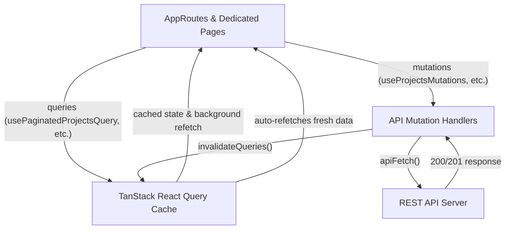
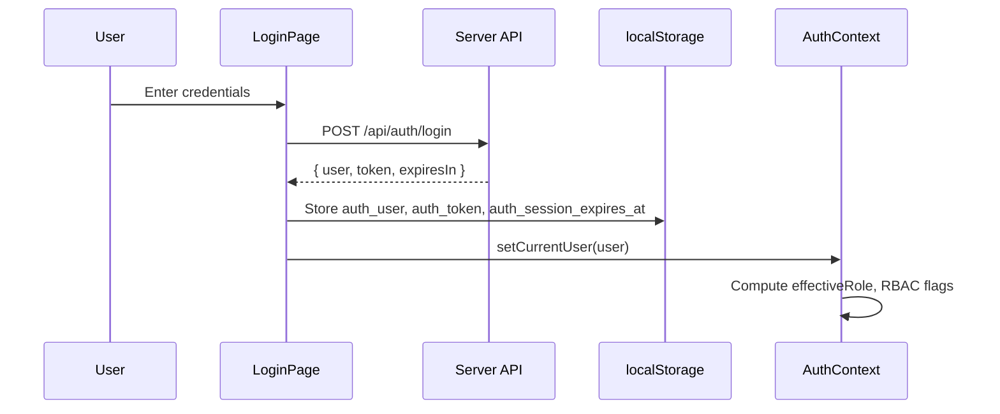
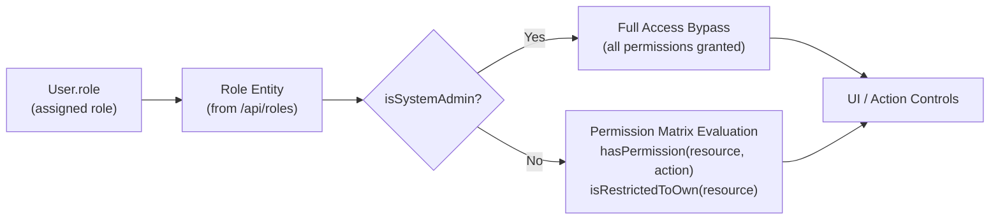
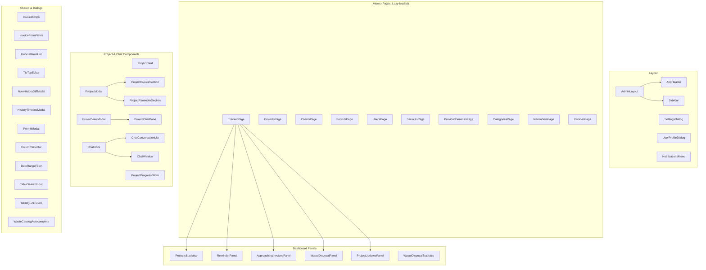
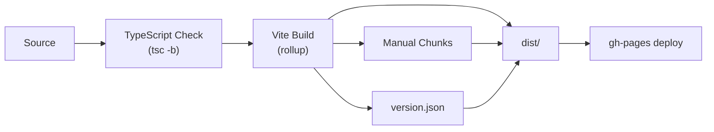
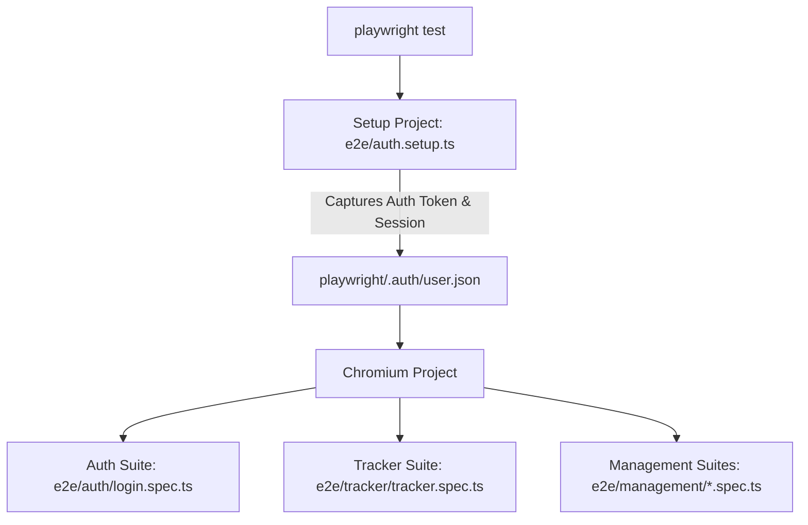

# Client Architecture — Ekos Project Tracker

> Comprehensive architecture reference for the client-side SPA.

---

## 1. Technology Stack

| Layer | Technology | Version |
|---|---|---|
| **Runtime** | React | 19.2.x |
| **Language** | TypeScript | 6.0.x |
| **Build Tool** | Vite | 8.3.x |
| **UI Framework** | Material UI (MUI) | 9.3.x |
| **CSS-in-JS** | Emotion | 11.14.x |
| **Charts** | MUI X Charts | 9.11.x |
| **Rich Text Editor** | TipTap (`@tiptap/react`, `@tiptap/starter-kit`, `@tiptap/extension-mention`, `@tiptap/extension-table`) | 3.20.x |
| **HTML Sanitizer** | DOMPurify | 3.3.x |
| **Offline Storage** | IndexedDB (`ekos_project_tracker_db`, `ekos_chat_cache_db`) + `BroadcastChannel` | Native Web APIs |
| **State & Caching** | TanStack React Query + Selective Query Persistence | 5.102.x |
| **Real-Time Messaging** | Server-Sent Events (SSE) (`fetch` stream reader) | Native Web APIs |
| **Linting** | oxlint | 1.75.x |
| **Deployment** | GitHub Pages (gh-pages) | 6.3.x |
| **Routing** | React Router DOM | 7.18.x |
| **E2E Testing** | Playwright | 1.64.x |
| **Unit Testing** | Vitest + Testing Library | 5.0.x / 16.3.x |
| **API Mocking** | MSW (Mock Service Worker) | 2.15.x |

Navigation is managed via **React Router DOM** with dynamic basename support (`getRouterBasename()`) for GitHub Pages and custom domain deployments. Centralized page routes are defined in [`src/constants/pageRoutes.ts`](../src/constants/pageRoutes.ts).

---

## 2. Application Bootstrap

```
index.html
  └── src/main.tsx
        ├── restorePersistedQueries(queryClient) & setupQueryPersistence(queryClient)
        ├── StrictMode
        └── QueryClientProvider
              └── BrowserRouter (basename={getRouterBasename()})
                    └── <App />
              ├── LanguageProvider        (i18n)
              │   └── AuthProvider        (auth + dynamic RBAC)
              │       └── NotificationProvider (notifications)
              │           └── LoadingProvider  (global loading mask)
              │               └── <MainApp />
              │                   └── CustomThemeProvider (MUI theme)
              │                       └── ProjectModalProvider (project modals)
              │                           └── ChatProvider (SSE stream + IndexedDB chat cache)
              │                               ├── <AdminLayout>
              │                               │   └── <AppRoutes />
              │                               └── <ChatDock />
              └── vite:preloadError handler (auto-reload on chunk miss)
```

### Provider Nesting Order (outermost → innermost)
1. **`LanguageProvider`** — i18n must be available to all other providers
2. **`AuthProvider`** — auth state consumed by notifications, chat, and layout
3. **`NotificationProvider`** — depends on `useAuth()` for user context
4. **`LoadingProvider`** — global loading state
5. **`CustomThemeProvider`** — MUI theme, depends on user preferences
6. **`ProjectModalProvider`** — global project view/edit modal orchestration
7. **`ChatProvider`** — real-time direct & contextual project messaging, SSE stream, and floating `ChatDock` orchestration

---

## 3. Application Architecture

### 3.1 `MainApp` & Decoupled Routing

[`App.tsx`](../src/App.tsx) is a lean root orchestrator (~65 lines) that:
- Coordinates top-level providers (`CustomThemeProvider`, `ProjectModalProvider`, `ChatProvider`)
- Wraps the authenticated shell (`AdminLayout`) and global floating `ChatDock`
- Delegates route declarations to [`src/routes/AppRoutes.tsx`](../src/routes/AppRoutes.tsx)
- Automatically checks deployment versions via `VersionUpdatePrompt`

### 3.2 Declarative Data Flow (TanStack React Query)



- **Query Isolation:** Each entity domain (`projects`, `clients`, `invoices`, `permits`, `reminders`, `services`, `providedServices`, `users`, `activity`, `history`, `preferences`, `company`, `systemSettings`, `autocomplete`) has dedicated query and mutation modules under `src/queries/`, re-exported through `src/queries/index.ts`.
- **Strict Server-Side Pagination:** All entity list views use paginated or infinite queries (`usePaginated*Query`, `useInfiniteProjectsQuery`) rather than unpaginated full-table fetches.
- **Automatic Cache Invalidation:** Mutations trigger query key invalidation (`queryClient.invalidateQueries({ queryKey: [...] })`), ensuring views update automatically without manual state prop-drilling.
- **Optimistic Updates:** User preferences (column visibility, theme mode, language, rows-per-page) are updated optimistically in the React Query cache before server persistence.
- **Selective Cache Persistence (`src/utils/queryPersistence.ts`):** Slow-changing user directory and summary queries (`['users', 'directory']`, `['users', 'summary']`) are persisted to `localStorage` and hydrated synchronously on boot.
- **Table Preferences Hook (`useTablePreferences(tableKey)`):** Eliminates prop-drilling of preference states from `App.tsx`. Pages directly consume their table preferences with local overrides.

### 3.3 State Management

| Mechanism | Usage |
|---|---|
| `TanStack React Query` | Server cache, background polling, paginated entity data & mutations |
| `useTablePreferences` | Reactive user table column visibility, rows per page, sorting |
| `useProjectModal` | Global modal orchestration for Project view/edit/new/diff modals |
| `useChat` | Real-time direct & contextual project chat state, SSE stream, multi-window dock |
| `useState` | Local UI state, active dialogs, transient form data |
| `useContext` | Auth, Language, Theme, Notifications, LoadingMask, ProjectModals, Chat |
| `useMemo` | Derived statistics, active filter calculations, expensive aggregations |
| `useCallback` | Event handlers and parameterized callback props |
| `localStorage` | JWT token (`auth_token`), authenticated user snapshot, theme, language, persisted user directory queries |
| `IndexedDB` | Waste catalog cache (`ekos_project_tracker_db`) and Chat message/conversation cache (`ekos_chat_cache_db`) |

### 3.4 1 Route -> 1 Page Structure

Navigation maps 1-to-1 with dedicated lazy-loaded pages declared in `src/routes/AppRoutes.tsx`:

#### App 1: Project Tracker (`src/pages/project-tracker/`)
| Path | Route Constant | Page Component |
|---|---|---|
| `/project-tracker/projects` | `PROJECT_TRACKER_PROJECTS` | `TrackerProjectsPage.tsx` |
| `/project-tracker/updates` | `PROJECT_TRACKER_UPDATES` | `TrackerUpdatesPage.tsx` |
| `/project-tracker/reminders` | `PROJECT_TRACKER_REMINDERS` | `TrackerRemindersPage.tsx` |
| `/project-tracker/invoices` | `PROJECT_TRACKER_INVOICES` | `TrackerInvoicesPage.tsx` |
| `/project-tracker/waste-disposal` | `PROJECT_TRACKER_WASTE` | `TrackerWasteDisposalPage.tsx` |
| `/project-tracker/statistic` | `PROJECT_TRACKER_STATISTICS` | `TrackerProjectsStatsPage.tsx` |
| `/project-tracker/statistic-waste-disposal` | `PROJECT_TRACKER_WASTE_STATISTICS` | `TrackerWasteStatsPage.tsx` |

#### App 2: Data Management (`src/pages/data-management/`)
| Path | Route Constant | Page Component |
|---|---|---|
| `/data-management/projects` | `PROJECTS` | `ProjectsPage.tsx` |
| `/data-management/clients` | `CLIENTS` | `ClientsPage.tsx` |
| `/data-management/permits` | `PERMITS` | `PermitsPage.tsx` |
| `/data-management/users` | `USERS` | `UsersPage.tsx` |
| `/data-management/roles` | `ROLES` | `RolesPage.tsx` |
| `/data-management/services` | `SERVICES` | `ServicesPage.tsx` |
| `/data-management/provided-services` | `PROVIDED_SERVICES` | `ProvidedServicesPage.tsx` |
| `/data-management/categories` | `CATEGORIES` | `CategoriesPage.tsx` |
| `/data-management/invoices` | `INVOICES` | `InvoicesPage.tsx` |
| `/data-management/reminders` | `REMINDERS` | `RemindersPage.tsx` |
| `/data-management/activity-logs` | `ACTIVITY_LOGS` | `ActivityLogsPage.tsx` |
| `/data-management/activity-logs/analytics` | `ACTIVITY_ANALYTICS` | `ActivityAnalyticsPage.tsx` |

---

## 4. Authentication & Authorization

### 4.1 Auth Flow



### 4.2 Role-Based Access Control (RBAC)



The system uses dynamic roles configured in the backend database. Default roles include:

| Role | Dashboard | Projects | Clients | Permits | Users | Services | ProvidedServices | Categories | Reminders | Invoices | Activity Logs |
|---|---|---|---|---|---|---|---|---|---|---|---|
| **Administrator** | ✅ | ✅ | ✅ | ✅ | ✅ | ✅ | ✅ | ✅ | ✅ | ✅ | ✅ |
| **Manager** | ✅ | ✅ | ✅ | ✅ | ✅ | ✅ | ✅ | ✅ | ✅ | ✅ | — |
| **Manager (User View)** | ✅ | — | — | — | — | — | — | — | — | — | — |
| **Accountant** | ✅ (invoice-focused) | — | — | — | — | — | — | — | — | — | — |
| **User** | ✅ (personal) | — | — | — | — | — | — | — | — | — | — |

**Manager "Work on Entities" toggle:** Managers can switch between full Manager mode (manage all entities) and a User-like view (only personal dashboard). Controlled via `workOnEntities` flag, persisted in localStorage and server preferences.

### 4.3 Session Management

- **JWT stored** in `localStorage` as `auth_token`
- **Session expiry** tracked client-side via `auth_session_expires_at` (timestamp)
- **Periodic auth check** every 30s via `GET /api/auth/me` — logs out blocked users
- **Session expiry check** every 15s — compares `Date.now()` against stored expiry
- **Page Visibility API** — all polling pauses when tab is hidden, resumes + immediate check on tab focus
- **`auth:expired` custom event** — dispatched by `apiFetch()` on 401, triggers global logout

---

## 5. Internationalization (i18n)

### Architecture

```
src/i18n/
├── translations.ts    ← Type definitions + shared maps
├── loader.ts          ← Dynamic import() based lazy loading
└── locales/
    ├── en.ts          ← English (~27KB)
    ├── sr-Latn.ts     ← Serbian Latin (~28KB) — DEFAULT
    └── sr-Cyrl.ts     ← Serbian Cyrillic (~38KB)
```

### Translation System

| Feature | Implementation |
|---|---|
| **Key lookup** | `t('key')` → string from active dictionary |
| **Interpolation** | `t('key', { count: 5 })` → replaces `{count}` in template |
| **Service labels** | `getServiceLabel(typeCode, services?)` → translated service name |
| **Gender-aware labels** | `getResponsibleLabel(userOrGender, usersList?)` → `Odgovoran/Odgovorna/Odgovorno` |
| **Error translation** | `getErrorMessage(rawError)` → localized error message |
| **Lazy loading** | Locale dictionaries loaded via dynamic `import()` — only active locale is bundled |

### Adding a Translation Key

1. Add the key to the `TranslationKeys` interface in [`translations.ts`](../src/i18n/translations.ts)
2. Add values in all 3 locale files (`en.ts`, `sr-Latn.ts`, `sr-Cyrl.ts`)
3. Use via `const { t } = useLanguage(); t('myNewKey');`

---

## 6. Theming

### Theme System

The app uses a custom MUI theme defined in [`theme.ts`](../src/theme/theme.ts):

| Aspect | Light Mode | Dark Mode |
|---|---|---|
| **Primary** | `#2e7d32` (Forest Green) | `#4caf50` (Green) |
| **Secondary** | `#16a34a` | `#34d399` (Emerald) |
| **Background** | `#f4f6f8` / `#ffffff` | `#0b130e` / `#132018` |
| **Text** | `#1b2c22` / `#516758` | `#f0f7f2` / `#9ec1a3` |

**Custom palette extension — `status`:**
| Status | Light | Dark | Used For |
|---|---|---|---|
| `active` | `#2e7d32` | `#4caf50` | Active projects |
| `done` | `#16a34a` | `#34d399` | Completed projects |
| `stale` | `#ed6c02` | `#fb923c` | Stale projects |

**Theme modes:** `light`, `dark`, `system` (auto-detects via `prefers-color-scheme`).

**Typography:** Inter font family, no text-transform on buttons, custom heading weights.

**Global overrides:** Scroll lock disabled on all overlays (Modal, Popover, Menu, Select, Dialog, Drawer) to prevent body scroll issues.

---

## 7. Component Architecture

### 7.1 Layout Shell

```
<AdminLayout>
  ├── <AppHeader />           — Top bar, user menu, notifications
  ├── <Sidebar />             — Navigation, sub-tabs, version
  ├── <main>                  — Active view content
  ├── <UserProfileDialog />   — Profile editor
  ├── <SettingsDialog />      — App settings
  └── <CompanyInfoModal />    — Company details
```

### 7.2 Component Categories



### 7.3 Table View Pattern

All 11 table-based views/panels follow this architecture:

```typescript
function MyPage(props: ViewProps & TableViewProps) {
  // 1. Table infrastructure
  const tableView = useTableView({
    defaultColumns: ['col1', 'col2'],
    visibleColumns: props.visibleColumns,
    onVisibleColumnsChange: props.onVisibleColumnsChange,
    defaultRowsPerPage: 25,
    rowsPerPageProp: props.rowsPerPage,
    onRowsPerPageChange: props.onRowsPerPageChange,
    defaultSortField: 'name',
    sortState: props.sortState,
    onSortChange: props.onSortChange,
    onRefresh: props.onRefresh,
  });

  // 2. CRUD operations
  const { handleSave, handleDelete } = useGenericMutations({
    basePath: '/api/my-entity',
    queryKeyToInvalidate: ['my-entity'],
    deleteConfirmMessageKey: 'confirmDelete',
    errorSaveMessageKey: 'errorSaving',
  });

  // 3. Render table with sorted/paginated data
  return <MuiTable>...</MuiTable>;
}
```

---

## 8. API Communication

### 8.1 API Client

All HTTP requests go through [`apiFetch()`](../src/api.ts):

```
apiFetch(path, init?)
  ├── Resolves full URL via VITE_API_BASE_URL
  ├── Auto-attaches Authorization: Bearer <token>
  ├── Calls native fetch()
  └── On 401 → dispatches 'auth:expired' event → auto logout
```

### 8.2 API Endpoints Consumed

| Endpoint | Methods | Used By |
|---|---|---|
| `/api/auth/login`, `/register`, `/me` | POST, GET | `AuthContext` |
| `/api/projects`, `/api/projects/:id` | GET, POST, PUT, DELETE | `projects.queries.ts` (`usePaginatedProjectsQuery`, `useInfiniteProjectsQuery`, `useProjectDetailsQuery`, `useProjectsMutations`) |
| `/api/projects/:id/toggle-done` | PATCH | `useProjectsMutations` |
| `/api/projects/statistics` | GET | `useProjectStatisticsQuery` (`TrackerProjectsStatsPage`) |
| `/api/projects/updates` | GET | `useProjectUpdatesQuery` (`TrackerUpdatesPage`) |
| `/api/projects/:id/note`, `/history`, `/diff`, `/restore/:v` | GET, PATCH, POST | `useProjectNoteQuery`, `NoteHistoryDiffModal` |
| `/api/clients`, `/api/clients/:id` | GET, POST, PUT, DELETE | `clients.queries.ts` (`usePaginatedClientsQuery`, `useClientsSummaryQuery`, `useClientsMutations`) |
| `/api/users`, `/api/users/:id` | GET, POST, PUT, DELETE | `users.queries.ts` (`usePaginatedUsersQuery`, `useUsersSummaryQuery`, `useUsersDirectoryQuery`, `useUsersMutations`) |
| `/api/users/:id/approve`, `/reject`, `/force-logout` | PATCH, POST | `useUsersMutations` |
| `/api/roles`, `/api/roles/:name` | GET, POST, PUT, DELETE | `useRolesQuery`, `RolesPage` |
| `/api/services`, `/api/services/:id` | GET, POST, PUT, DELETE | `services.queries.ts` (`usePaginatedServicesQuery`, `useServiceDetailsQuery`, `useServicesMutations`) |
| `/api/provided-services`, `/api/provided-services/:id` | GET, POST, PUT, DELETE | `providedServices.queries.ts` (`usePaginatedProvidedServicesQuery`, `useProvidedServicesMutations`) |
| `/api/provided-services/statistics/waste`, `/clients` | GET | `useWasteStatisticsQuery`, `useWasteDisposalClientsQuery` (`TrackerWasteStatsPage`) |
| `/api/categories`, `/api/categories/:id` | GET, POST, PUT, DELETE | `useCategoriesQuery`, `useCategoriesMutations` |
| `/api/reminders`, `/api/reminders/:id`, `/status` | GET, POST, PUT, DELETE, PATCH | `reminders.queries.ts` (`usePaginatedRemindersQuery`, `useRemindersMutations`) |
| `/api/invoices`, `/api/invoices/:id`, `/status` | GET, POST, PUT, DELETE, PATCH | `invoices.queries.ts` (`usePaginatedInvoicesQuery`, `useInvoicesMutations`) |
| `/api/permits`, `/api/permits/:id` | GET, POST, PUT, DELETE | `permits.queries.ts` (`usePaginatedPermitsQuery`, `usePermitsSummaryQuery`, `usePermitsMutations`) |
| `/api/waste-catalog` | GET, POST, PUT, DELETE | `useWasteCatalogQuery`, `wasteCatalogStorage.ts` |
| `/api/notifications`, `/read`, `/mark-all-read`, `/clear-all` | GET, PATCH, DELETE | `NotificationContext`, `systemSettings.queries.ts` |
| `/api/company-info` | GET, PUT | `company.queries.ts`, `CompanyInfoModal` |
| `/api/preferences`, `/api/preferences/:key` | GET, PUT | `preferences.queries.ts` (`usePreferencesQuery`, `useTablePreferences`) |
| `/api/system-settings`, `/api/system-settings/:key` | GET, PUT | `systemSettings.queries.ts` (`useSystemSettingsQuery`, `useWasteDisposalServiceId`) |
| `/api/activity-logs`, `/analytics`, `/status` | GET, POST, PATCH, DELETE | `activity.queries.ts`, `useActivityTracker` |
| `/api/history/:entityType/:id`, `/diff`, `/versions/:v`, `/restore/:v` | GET, POST | `history.queries.ts`, `HistoryTimelineModal` |
| `/api/chat/*` | GET, POST, PATCH, DELETE | `ChatContext.tsx`, `src/components/chat/chatApi.ts` |

### 8.3 Dev Server Proxy

```typescript
// vite.config.ts
server: {
  port: 3000,
  proxy: {
    "/api": {
      target: "http://localhost:5000",
      changeOrigin: true,
    },
  },
},
```

---

## 9. Build & Deployment

### 9.1 Build Pipeline



### 9.2 Chunk Strategy

| Chunk Name | Contents | Rationale |
|---|---|---|
| `vendor-react` | react, react-dom | Rarely changes, long cache |
| `vendor-mui` | @mui/material, @emotion/* | Large, stable |
| `vendor-mui-icons` | @mui/icons-material | Tree-shaken via barrel file |
| `vendor-mui-charts` | @mui/x-charts | Only used in dashboard analytics |
| Per-view chunks | Each lazy-loaded view | Code-split per route |

### 9.3 Version System

Build-time globals injected via Vite `define`:
- `__APP_VERSION__` — from git tag → package.json → `1.0.0`
- `__COMMIT_HASH__` — `git rev-parse --short HEAD`
- `__BUILD_TIME__` — ISO timestamp

Runtime `version.json` emitted to `dist/` — polled by `useVersionCheck` hook to detect new deployments and show an update banner.

### 9.4 CI/CD

Automated via GitHub Actions:
- **E2E Testing (`.github/workflows/playwright.yml`)**: Runs Playwright test suite against headless Chromium on push/PR to `main`/`master`, with automatic artifact upload of trace recordings and reports on failure.
- **Release & Deployment Workflow**: On PR merge to `main`:
  1. Determine version bump from PR labels/title (conventional commits)
  2. Bump `package.json` version
  3. Update `CHANGELOG.md`
  4. Create git tag + GitHub Release
  5. Trigger deploy to GitHub Pages

---

## 10. Testing Architecture

### 10.1 Unit & Component Testing (Vitest)
- **Runner**: Vitest with `@testing-library/react` and `jsdom`.
- **API Mocking**: Mock Service Worker (MSW) in `src/mocks` simulates backend endpoints for component-level isolation.
- **Coverage**: Evaluated via `npm run test:coverage`.

### 10.2 End-to-End Testing (Playwright)
The application includes an automated E2E testing framework powered by `@playwright/test` located in `client/e2e/`:



- **Global Setup (`e2e/auth.setup.ts`)**: Authenticates against the backend once and persists JWT session state to `playwright/.auth/user.json`.
- **Suites**:
  - `auth/login.spec.ts`: Valid/invalid logins, error display, logout flows.
  - `tracker/tracker.spec.ts`: KPI cards, active projects overview, quick filters.
  - `management/projects.spec.ts`: Project creation, edit, quick filter tabs, delete.
  - `management/clients.spec.ts`: Client CRUD, permit association.
  - `management/invoices.spec.ts`: Invoice creation, status changes, items.
  - `management/services.spec.ts`: Service types and custom schema definitions.
  - `management/permits.spec.ts`: Permit validity dates and waste catalog links.
  - `management/users.spec.ts`: User listing, approval workflows, role filters.
  - `management/categories.spec.ts`: Category CRUD.
  - `management/reminders.spec.ts`: Reminder status transitions and alerts.
  - `management/activity-logs.spec.ts`: Audit trail event tracking and search.
- **Configuration (`playwright.config.ts`)**:
  - Automatically spins up the dev server (`npm run dev`) on `http://localhost:3000`.
  - Captures traces on failure (`trace: 'on-first-retry'`).
  - Reports in console (`list`) and generates HTML reports (`html`).

---

## 11. Real-Time Chat & Contextual Messaging Architecture

The client features an integrated real-time messaging system supporting **Direct 1-on-1**, **Group**, and **Contextual Project** conversations (`src/context/ChatContext.tsx` and `src/components/chat/`):

```mermaid
sequenceDiagram
    participant UI as ChatDock / ProjectChatPane
    participant CC as ChatContext
    participant IDB as chatStorage.ts (IndexedDB)
    participant SSE as /api/chat/stream (SSE)
    participant API as /api/chat/* REST

    CC->>IDB: getCachedConversations() (0ms instant boot)
    CC->>API: GET /api/chat/conversations
    API-->>CC: Conversations + serverSeq /unreadCount
    CC->>IDB: compare cursorSeq vs serverSeq
    alt Server has newer messages (serverSeq > cursorSeq)
        CC->>API: GET /api/chat/conversations/:id/messages?sinceSeq=<cursorSeq>
        API-->>CC: Delta messages + syncDeletedIds
        CC->>IDB: upsertCachedMessages() & setConversationCursor()
    end
    CC->>SSE: Open persistent fetch SSE stream (with Authorization header)
    SSE-->>CC: Events: message:new, message:updated, message:deleted, conversation:read, typing, presence
    Note over CC,SSE: Pauses stream after 5m user inactivity (IDLE_TIMEOUT_MS); wakes & delta-syncs on focus/activity
```

### Key Architectural Pillars
1. **Multi-Window Floating `ChatDock` & Contextual `ProjectChatPane`**:
   - Up to 3 floating chat windows can be docked simultaneously at the bottom of the screen, or minimized into compact tabs.
   - Opening a project in `ProjectViewModal` mounts `ProjectChatPane`, lazily resolving or creating the contextual `PROJECT` conversation (`POST /api/chat/conversations/project/:projectId`).
2. **Sequence-Number IndexedDB Cache (`src/components/chat/chatStorage.ts`)**:
   - Stores conversations, messages (up to 400 per conversation), and per-conversation sequence cursors in IndexedDB (`ekos_chat_cache_db`).
   - Reconciles incremental message deltas using monotonically increasing `seq` numbers (`?sinceSeq=`) and purges tombstoned message IDs (`syncDeletedIds`).
3. **Idle-Aware SSE Connection Management**:
   - Uses a `fetch()` stream reader to pass the `Authorization: Bearer <token>` header to `GET /api/chat/stream`.
   - Automatically enters `sleeping` mode after 5 minutes of user inactivity (`IDLE_TIMEOUT_MS`) to conserve server connections and wakes immediately on mouse/keyboard/visibility activity.

---

## 12. Multi-Tier Waste Catalog Persistence & Selective Query Cache

### 12.1 Waste Catalog Persistence (`src/utils/wasteCatalogStorage.ts`)
The Serbian national waste index contains ~1,000 regulatory waste codes. Transferring and rendering this catalog on every lookup is avoided through a 3-tier persistence strategy:

1. **Tier 1 — In-Memory Cache**: 0ms synchronous read access for active autocomplete components and dropdowns.
2. **Tier 2 — IndexedDB Persistence (`ekos_project_tracker_db`)**: Durable browser database holding catalog items and sync metadata (`waste_catalog_meta`). Survives full page reloads, tab closes, and browser restarts.
3. **Tier 3 — Cross-Tab Broadcast Synchronization (`BroadcastChannel`)**: Multiple open browser tabs communicate via `ekos_waste_catalog_sync`. When an item is added, edited, or deleted in one tab, other tabs immediately invalidate their in-memory cache and dispatch `ekos:waste-catalog-updated` window events.
4. **Automated Delta Polling**: Background delta queries (`GET /api/waste-catalog?since=...`) update local IndexedDB records incrementally with tombstone deletion support.

### 12.2 Selective Query Cache Persistence (`src/utils/queryPersistence.ts`)
Slow-changing reference queries (`['users', 'directory']` and `['users', 'summary']`) are selectively persisted in `localStorage` (`STORAGE_KEYS.QUERY_CACHE_PERSIST`, 24h max age) and hydrated prior to initial render via `restorePersistedQueries(queryClient)`. All cache entries are wiped automatically upon logout (`clearPersistedQueries()`).

---

## 13. Rich Text & Note Revision History Architecture

Project notes use a dedicated TipTap editing engine and delta revision subsystem:

1. **TipTap Rich Text Editor Suite (`src/components/common/tiptap/`)**:
   - Built on TipTap 3 + ProseMirror (`TipTapEditor.tsx`).
   - Features custom formatting toolbar (`TipTapToolbar.tsx`), table creation/editing extensions, heading levels, blockquotes, and lists.
   - Mention autocomplete system (`MentionSuggestionList.tsx`, `mentionExtension.ts`) linking project team members directly into notes.
   - Client-side sanitization via **DOMPurify** preventing stored XSS injection.
2. **Microsoft Word & XML Sanitizer (`cleanWordHtml.ts`, `stripHtmlToText.ts`)**:
   - Strips proprietary Microsoft Word XML metadata, Office classes, and mso formatting on paste.
   - Decodes HTML entities and strips non-breaking space sequences (`&nbsp;`, `\u00A0`).
3. **Note History & Diff Inspector (`src/components/history/NoteHistoryDiffModal.tsx`)**:
   - Inspects full revision timeline per project note (`/api/projects/:id/note/history`).
   - Side-by-side visual diff and unified patch inspection (`/api/projects/:id/note/diff`).
   - One-click historical version restoration (`POST /api/projects/:id/note/restore/:v`).

---

## 14. Directory Structure

```
client/
├── .github/
│   ├── dependabot.yml              # Automated dependency PR grouping
│   └── workflows/
│       ├── bump-version.yml        # PR-driven semver bumping
│       ├── deploy.yml              # GitHub Pages deployment
│       └── playwright.yml          # Automated Playwright E2E testing
├── docs/                           # Documentation (AI context, Architecture, API reference)
│   ├── AI_CONTEXT.md               # Fast orientation for AI coding assistants
│   ├── API_REFERENCE.md            # Client REST API specifications
│   └── ARCHITECTURE.md             # Comprehensive client architectural reference
├── e2e/                            # Playwright End-to-End test suites
│   ├── auth.setup.ts               # Global authenticated session fixture
│   ├── auth/                       # Login & session tests
│   ├── tracker/                    # Dashboard & project notes tests
│   ├── management/                 # Entity management CRUD tests
│   └── helpers/
│       └── mockApi.ts              # E2E network mocking helper
├── playwright.config.ts            # Playwright test runner configuration
├── public/                         # Static assets (favicons, version.json)
├── src/
│   ├── api.ts                      # API client wrapper (apiFetch)
│   ├── main.tsx                    # ReactDOM entry point & query cache hydration
│   ├── App.tsx                     # Root orchestrator & top-level providers
│   ├── App.css                     # Component styling overrides
│   ├── index.css                   # Global styles, variables, typography
│   ├── assets/                     # SVG logos and media
│   ├── constants/                  # Centralized route, key, time, and domain constants
│   │   ├── apiRoutes.ts            # API endpoints & URL builders (API_ROUTES)
│   │   ├── pageRoutes.ts           # Client navigation paths (PAGE_ROUTES)
│   │   ├── domain.ts               # Domain constants & pagination defaults
│   │   ├── errorCodes.ts           # Standardized API error codes
│   │   ├── permissions.ts          # RBAC resource & action constants
│   │   ├── queryKeys.ts            # Centralized React Query cache keys
│   │   ├── storage.ts              # Storage & IndexedDB key constants
│   │   ├── time.ts                 # Polling, debounce, and cache TTL constants
│   │   └── index.ts
│   ├── routes/                     # Centralized route declarations
│   │   ├── AppRoutes.tsx           # 1 Route -> 1 Page lazy router
│   │   └── index.ts
│   ├── types/                      # Modular domain TypeScript definitions
│   │   ├── index.ts                # Barrel export
│   │   ├── common.types.ts
│   │   ├── auth.types.ts
│   │   ├── project.types.ts
│   │   ├── client.types.ts
│   │   ├── permit.types.ts
│   │   ├── invoice.types.ts
│   │   ├── reminder.types.ts
│   │   ├── service.types.ts
│   │   ├── activity.types.ts
│   │   └── globals.d.ts
│   ├── queries/                    # Modular TanStack React Query hooks
│   │   ├── index.ts                # Barrel export
│   │   ├── queryUtils.ts
│   │   ├── preferences.queries.ts  # usePreferencesQuery, useTablePreferences(tableKey)
│   │   ├── projects.queries.ts
│   │   ├── clients.queries.ts
│   │   ├── permits.queries.ts
│   │   ├── invoices.queries.ts
│   │   ├── reminders.queries.ts
│   │   ├── services.queries.ts
│   │   ├── providedServices.queries.ts
│   │   ├── users.queries.ts
│   │   ├── activity.queries.ts
│   │   ├── history.queries.ts
│   │   ├── company.queries.ts
│   │   ├── systemSettings.queries.ts
│   │   └── autocomplete.queries.ts
│   ├── context/                    # React context providers
│   │   ├── AuthContext.tsx         # Auth + dynamic RBAC
│   │   ├── ProjectModalContext.tsx # Project view/edit modal orchestration
│   │   ├── ChatContext.tsx         # Real-time SSE messaging & multi-window dock state
│   │   ├── LanguageContext.tsx     # i18n
│   │   ├── ThemeContext.tsx        # MUI theming
│   │   ├── NotificationContext.tsx # @mention notifications
│   │   └── LoadingContext.tsx      # Global loading mask
│   ├── hooks/                      # Custom React hooks
│   │   ├── useTableView.ts         # Shared table infrastructure
│   │   ├── useProjectForm.ts       # Project form state
│   │   ├── useInvoiceFormState.ts  # Invoice form state
│   │   ├── useActivityTracker.ts   # Session tracking, idle detection, multi-tab sync
│   │   ├── useLinkedListOptions.ts # Dynamic options & cascaded dependencies
│   │   ├── useVersionCheck.ts      # Deployment update detection
│   │   ├── useRoleLabels.ts        # Role translation
│   │   └── useDebounce.ts          # Value debounce hook
│   ├── pages/                      # 1 Route -> 1 Page view components
│   │   ├── auth/                   # Authentication pages (LoginPage)
│   │   ├── project-tracker/        # App 1: 7 dedicated Project Tracker pages
│   │   │   ├── TrackerProjectsPage.tsx
│   │   │   ├── TrackerUpdatesPage.tsx
│   │   │   ├── TrackerRemindersPage.tsx
│   │   │   ├── TrackerInvoicesPage.tsx
│   │   │   ├── TrackerWasteDisposalPage.tsx
│   │   │   ├── TrackerProjectsStatsPage.tsx
│   │   │   └── TrackerWasteStatsPage.tsx
│   │   └── data-management/        # App 2: 12 dedicated Data Management pages
│   │       ├── ProjectsPage.tsx
│   │       ├── ClientsPage.tsx
│   │       ├── PermitsPage.tsx
│   │       ├── UsersPage.tsx
│   │       ├── RolesPage.tsx
│   │       ├── ServicesPage.tsx
│   │       ├── ProvidedServicesPage.tsx
│   │       ├── CategoriesPage.tsx
│   │       ├── InvoicesPage.tsx
│   │       ├── RemindersPage.tsx
│   │       ├── ActivityLogsPage.tsx
│   │       └── ActivityAnalyticsPage.tsx
│   ├── components/                 # Domain-grouped components
│   │   ├── common/                 # Generic building blocks (dialogs/, modal/, tiptap/, autocomplete/)
│   │   ├── layout/                 # AdminLayout, AppHeader, Sidebar, Settings, Profile, Notifications
│   │   ├── chat/                   # ChatDock, ChatWindow, ChatConversationList, ProjectChatPane, chatApi, chatStorage
│   │   ├── project/                # ProjectCard, ProjectModal, ProjectViewModal, Sections
│   │   ├── client/                 # ClientModal
│   │   ├── permit/                 # PermitModal, PermitsTable, StatusBadge, Reminders
│   │   ├── invoice/                # InvoiceModal, FormFields, ItemsList, Chips, RowDetail
│   │   ├── reminder/               # ReminderModal
│   │   ├── service/                # ServiceModal, CustomDataModelModal
│   │   ├── providedService/        # ProvidedServiceModal, InvoiceSection
│   │   ├── waste/                  # WasteCatalogModal
│   │   ├── user/                   # UserModal
│   │   ├── role/                   # RoleModal
│   │   ├── company/                # CompanyInfoModal
│   │   ├── statistics/             # ProjectsStatistics, WasteDisposalStatistics
│   │   ├── history/                # HistoryTimelineModal, NoteHistoryDiffModal, HistoryDiffView
│   │   ├── activityLogs/           # Audit log tables & diffs
│   │   ├── activityAnalytics/      # Activity analytics charts & KPI panels (15 modules)
│   │   └── icons.ts                # Barrel file for ~90 tree-shaken MUI icons
│   ├── i18n/                       # Internationalization
│   │   ├── translations.ts         # Types + shared maps
│   │   ├── loader.ts               # Lazy locale loading
│   │   └── locales/                # en.ts, sr-Latn.ts, sr-Cyrl.ts
│   ├── theme/                      # MUI theme configuration
│   ├── utils/                      # Query persistence, waste catalog IndexedDB, HTML sanitation, invoice & custom field helpers
│   ├── tests/                      # Test harness & test-utils.tsx
│   └── mocks/                      # MSW handlers & server
├── package.json
├── tsconfig.json
├── tsconfig.app.json
├── tsconfig.node.json
├── vite.config.ts
├── .oxlintrc.json
├── CHANGELOG.md
├── README.md
├── SECURITY.md
└── VERSIONING.md
```
